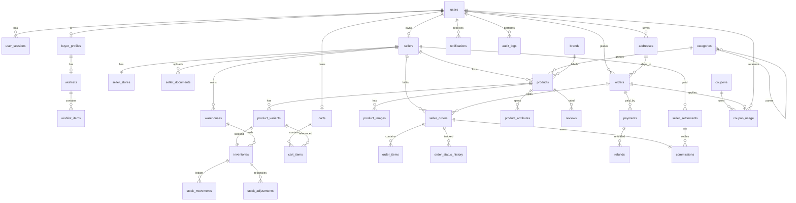

# ShopSphere Database Design

PostgreSQL via Prisma. Conventions: `id` UUID (v7/`uuid()`), `createdAt/updatedAt`, `deletedAt` for soft-deletable entities, money as integer **paise**, enums for statuses, FKs with explicit `onDelete`.

## ER diagram

## Tables (key columns)
**Auth**: `users(id, email unique, passwordHash, role enum, name, phone, status, failedLogins, lockedUntil, deletedAt)` · `user_sessions(id, userId, refreshTokenHash, familyId, expiresAt, revokedAt, ip, userAgent)` · `roles` are an enum on users (documented as the "roles" entity; a table adds no value for 3 fixed roles).
**Buyer**: `buyer_profiles`, `addresses(label, name, phone, line1, line2, city, state, pincode, isDefault)`, `wishlists`, `wishlist_items(wishlistId, productId unique pair)`.
**Seller**: `sellers(userId, status PENDING|APPROVED|REJECTED|SUSPENDED, businessName, gstin, pan, rejectionReason, approvedAt, approvedById)`, `seller_stores(name, slug unique, description, logoUrl, bannerUrl, contact*)`, `seller_documents(type, url, status)`.
**Catalogue**: `categories(parentId, slug unique, sortOrder)`, `brands`, `products(sellerId, categoryId, brandId, name, slug unique, description, mrpPaise, pricePaise, status DRAFT|ACTIVE|ARCHIVED, approval PENDING|APPROVED|REJECTED|SUSPENDED, ratingAvg, ratingCount, soldCount, deletedAt)`, `product_images(url, publicId, position)`, `product_variants(productId, sku unique, optionValues jsonb, pricePaise?, mrpPaise?)`, `product_attributes(key, value, position)`.
**Inventory**: `warehouses(sellerId, name, location)`, `inventories(variantId unique, warehouseId, available, reserved, sold, reorderLevel; CHECK >=0)`, `stock_movements(inventoryId, sellerId, type OPENING|INWARD|OUTWARD|ADJUSTMENT|RESERVE|RELEASE|SALE|RETURN_RESTOCK|RECONCILIATION, previousQty, changeQty, newQty, reason, referenceNo, createdById, createdAt; append-only)`, `stock_adjustments(inventoryId, expectedQty, countedQty, difference, reason, status)`.
**Shopping**: `carts(userId unique)`, `cart_items(cartId, variantId, qty; unique pair)`.
**Orders**: `orders(orderNo unique, buyerId, addressSnapshot jsonb, subtotal, discount, delivery, tax, total, status, idempotencyKey unique)`, `seller_orders(orderId, sellerId, subtotal, tax, delivery, total, commissionPaise, status, trackingNo, carrier)`, `order_items(sellerOrderId, variantId, productNameSnapshot, skuSnapshot, unitPricePaise, qty, lineTotal)`, `order_status_history(entity, entityId, from, to, actorId, note)`.
**Finance**: `payments(orderId, method UPI|CARD|COD, status, amount, demoReference)`, `refunds(paymentId, sellerOrderId, amount, reason, status)`, `commissions(sellerOrderId unique, ratePercentBp, amountPaise, netSellerPaise, settlementId?)`, `seller_settlements(sellerId, periodStart, periodEnd, gross, commission, net, status)`.
**Marketing/CX/Admin**: `coupons(code unique, type PERCENT|FLAT, value, minOrder, maxDiscount, usageLimit, validFrom/To, active)`, `coupon_usage`, `reviews(productId, userId, rating 1-5, title, body; unique productId+userId)`, `notifications(userId, type, title, body, readAt)`, `audit_logs(actorId, action, entity, entityId, meta jsonb, ip)`, `platform_settings(key pk, value jsonb)`, `idempotency_keys(key, userId, responseHash)`.

## Indexes (initial)
`products(approval,status,categoryId)`, `products(sellerId)`, GIN/`pg_trgm` on `products.name` and `product_variants.sku` for search, `products(pricePaise)`, `products(createdAt desc)`, `orders(buyerId,createdAt desc)`, `seller_orders(sellerId,status,createdAt desc)`, `stock_movements(inventoryId,createdAt desc)`, `stock_movements(sellerId,createdAt)`, `inventories(available)` partial for low stock, `reviews(productId)`, `notifications(userId,readAt)`, `user_sessions(userId)`.

## Integrity rules
Append-only `stock_movements` via trigger; `CHECK (available >= 0 AND reserved >= 0)`; order item snapshots never updated; soft-delete on users/products/sellers; money never floats; seeded data uses the same services as the API where possible to keep ledgers consistent.
